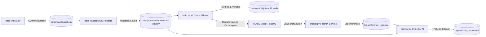

# Production-Ready End-to-End MLOps Blueprint

A modular, local-first, end-to-end MLOps platform covering data ingestion, schema validation, experiment tracking, model registry, resilient inference serving, drift monitoring, CI/CD, and containerization.

---

## 1. Architecture Overview



---

## 2. Directory Structure

```text
.
├── .github/
│   └── workflows/
│       └── ci.yml              # GitHub Actions CI pipeline
├── data/
│   ├── raw/                    # Raw generated datasets (.gitkeep)
│   └── processed/              # Validated train and test datasets (.gitkeep)
├── logs/                       # Production inference logging (.csv)
├── reports/                    # Generated Evidently AI drift reports (.html)
├── src/
│   ├── __init__.py
│   ├── config.py               # Centralized configuration, paths, and settings
│   ├── data_ingest.py          # Synthetic dataset generation
│   ├── data_validation.py      # Pandera schema validation and train/test split
│   ├── train.py                # Random Forest training and MLflow Model Registry
│   ├── predict.py              # FastAPI inference service with resilient CSV logging
│   └── monitor.py              # Evidently AI drift and quality report generator
├── tests/
│   ├── __init__.py
│   └── test_pipeline.py        # Pytest test suite (Pandera, endpoints, logs)
├── .gitignore                  # Git ignore rules
├── Dockerfile                  # Multi-stage Python 3.11-slim container
├── dvc.yaml                    # DVC pipeline stages (ingest -> validate -> train)
├── requirements.txt            # Pinned dependency versions
└── README.md                   # Project documentation
```

---

## 3. Quickstart & Local Setup

### Step 1: Create and Activate Virtual Environment

```bash
# Create Python 3.11 virtual environment
python -m venv .venv

# On Linux / macOS
source .venv/bin/activate

# On Windows (PowerShell)
.\.venv\Scripts\Activate.ps1
```

### Step 2: Install Pinned Dependencies

```bash
pip install --upgrade pip
pip install -r requirements.txt
```

---

## 4. Pipeline Execution Walkthrough

Run each module sequentially from the repository root:

### 1. Ingest Data
Generates 1,000 synthetic binary classification samples with 5 numeric features and writes to `data/raw/dataset.csv`:
```bash
python src/data_ingest.py
```

### 2. Validate Data Schema
Validates feature types, nulls, and value ranges with Pandera, then writes `data/processed/train.csv` and `data/processed/test.csv`:
```bash
python src/data_validation.py
```

### 3. Train Model & Register in MLflow
Trains a `RandomForestClassifier`, logs metrics, parameters, and confusion matrix artifacts to local SQLite `mlflow.db`, and registers the model to the MLflow Model Registry with `@champion` and `Production` aliases:
```bash
python src/train.py
```

### 4. Launch MLflow UI
View experiment tracking runs, metrics, and registered model versions:
```bash
mlflow ui --backend-store-uri sqlite:///mlflow.db
```
Open [http://localhost:5000](http://localhost:5000) in your browser.

### 5. Launch FastAPI Inference Service
Starts the REST inference server on port 8000:
```bash
uvicorn src.predict:app --host 0.0.0.0 --port 8000 --reload
```

#### Health Check
```bash
curl -X GET http://localhost:8000/health
```

*Response:*
```json
{
  "status": "healthy",
  "model_loaded": true,
  "model_name": "prod_model",
  "model_version": "models:/prod_model@champion",
  "tracking_uri": "sqlite:///mlflow.db",
  "timestamp": "2026-11-24T12:00:00.000000+00:00"
}
```

#### Run Prediction (Single Record)
```bash
curl -X POST http://localhost:8000/predict \
     -H "Content-Type: application/json" \
     -d '{
       "feature_1": 0.52,
       "feature_2": -1.14,
       "feature_3": 0.88,
       "feature_4": 0.12,
       "feature_5": -0.65
     }'
```

*Response:*
```json
{
  "predictions": [1],
  "probabilities": [0.89],
  "model_version": "models:/prod_model@champion",
  "count": 1
}
```

*Inference Logging:* Every request is appended thread-safely to `logs/inference_logs.csv` with feature values, prediction, probability, and timestamp.

### 6. Generate Data Drift Report
Analyzes drift between baseline `data/processed/train.csv` and live `logs/inference_logs.csv` using Evidently AI:
```bash
python src/monitor.py
```
Open `reports/drift_report.html` in your browser to view the interactive HTML report.

---

## 5. DVC Pipeline Execution

Execute all reproducible data pipeline stages defined in `dvc.yaml`:

```bash
# Initialize DVC (if not already initialized)
dvc init --no-scm

# Reproduce pipeline stages
dvc repro
```

---

## 6. Running Tests

Run the complete test suite with Pytest:

```bash
pytest tests/ -v
```

Tests cover:
- Pandera schema validation (boundary checks, null checks, target assertions)
- Synthetic data generator integrity
- FastAPI `/health` endpoint
- FastAPI `/predict` single and batch endpoints
- Automatic directory creation and CSV logging

---

## 7. Docker Build & Deployment

Build and run the multi-stage, non-root production container:

```bash
# Build Docker image
docker build -t mlops-blueprint:latest .

# Run container on port 8000
docker run -d --name mlops-service -p 8000:8000 mlops-blueprint:latest

# Check container health
curl -f http://localhost:8000/health

# Stop and remove container
docker stop mlops-service && docker rm mlops-service
```
